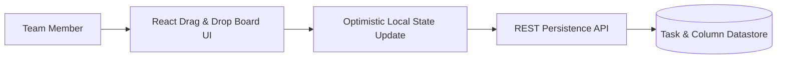

<div align="center">

# 📋 TaskPilot — Enterprise Agile Kanban & Workflow Engine

<p align="center">
  <strong>Fluid Drag-and-Drop Task Management, Sprint Velocity Tracking, and Real-Time Team Collaboration</strong>
</p>

<p align="center">
  
  
  
  
</p>

<p align="center">
  <a href="#-system-overview">Overview</a> •
  <a href="#-architecture--drag--drop-engine">Architecture</a> •
  <a href="#-features">Features</a> •
  <a href="#-local-preview">Quick Start</a>
</p>

</div>

---

## 📌 System Overview

TaskPilot provides agile engineering teams with an intuitive, zero-latency board management solution:
- **Optimistic Drag-and-Drop:** Smooth column reordering and card transfers with instant visual feedback.
- **Priority & Due Date Flags:** Color-coded urgency matrices for deadline prioritization.
- **Sprint Lane Filtering:** Instant filtering by assignee, tag, or milestone.

---

## 🛠️ Architecture & Drag-&-Drop Engine



---

## ✨ Features

- 🎯 **Smooth Physics-Based Dragging:** Responsive gesture handling on desktop and touch devices.
- 🏷️ **Tagging & Metadata Customization:** Create bespoke labels for bugs, features, spikes, and chores.
- ⚡ **Offline Resilient:** Changes queue locally during intermittent network drops.

---

## 🚀 Local Preview

```bash
# 1. Frontend
cd frontend
npm install
npm run dev
```

Open `http://localhost:5173` to interact with the task board.

---

<div align="center">

**Architected & Engineered by Nikhil**  
*Lead Full-Stack & Systems Platform Developer*

</div>
